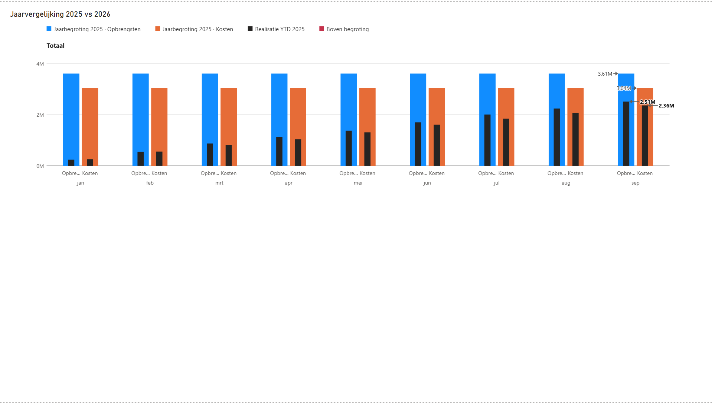
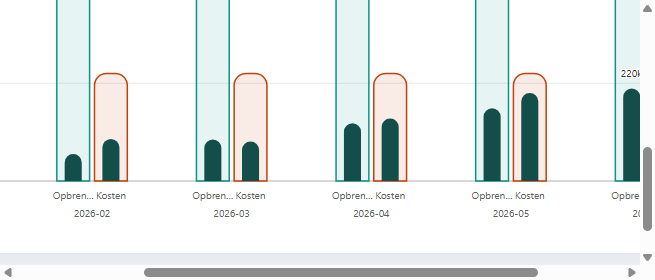
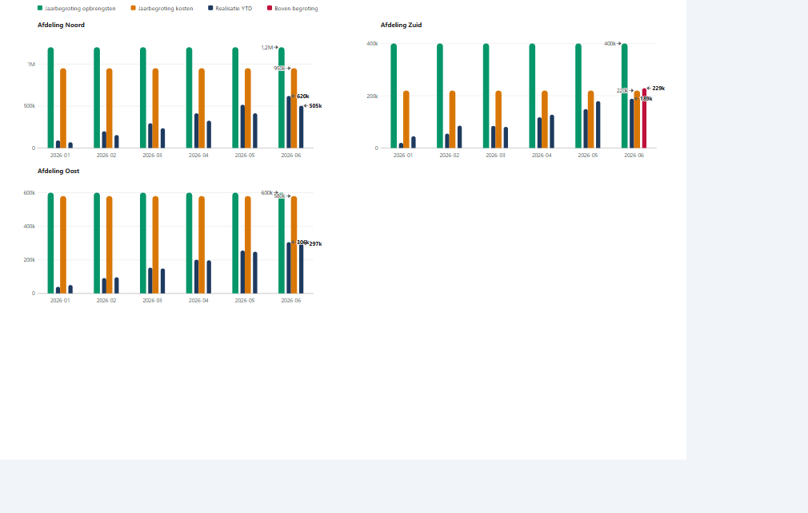
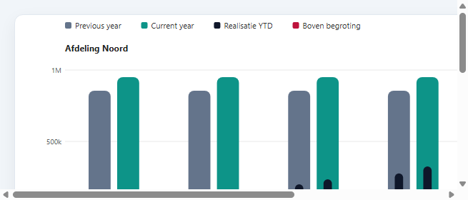
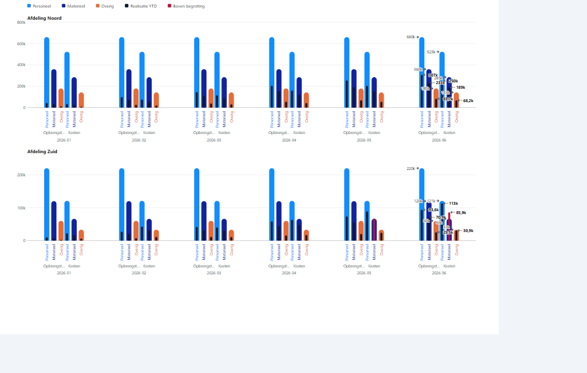

# Budget Bullet Chart

Power BI custom visual for **annual budget versus year-to-date actuals**, with optional revenue/cost split, targets, overrun markers, and cross-highlight support.


## Features

- Vertical or horizontal bullet-style bars (budget range + YTD actual)
- Separate **Opbrengsten** / **Kosten** series (or year-over-year budget/actual pairs)
- One panel per category (e.g. department)
- Budget styles: solid, light, or **outline**
- Rounded corners, beside/overlay actuals, target line or dot
- Legend field for extra series coloring
- Cross-highlight: partial bars and value labels at the highlighted ends

## Install

1. Download [`dist/*.pbiviz`](dist/) from this repo (or [Releases](https://github.com/TacodeJong/budgetBulletChart/releases) / `npm install` → `pbiviz package`).
2. In Power BI Desktop: **Insert → More visuals → From a file** and select the `.pbiviz`.

## Sample report

| File | Description |
|------|-------------|
| [`samples/BudgetBulletChart-sample.pbix`](samples/BudgetBulletChart-sample.pbix) | Ready-to-open sample report |
| [`samples/pbip/`](samples/pbip/) | Same report as a Power BI Project (`.pbip`) |
| [`dist/`](dist/) | Packaged `.pbiviz` |
| [`samples/budget-sample.csv`](samples/budget-sample.csv) | Source data |

Showcase pages:

1. **Highlight** — vertical stack, teal/blue palette, rounded bars, cross-highlight from the department chart  
2. **Horizontaal** — horizontal layout, soft fill, rounded corners, target as dot  
3. **Outline** — accented budget outlines with filled actuals  
4. **Kleuren** — high-contrast greens/ambers, actual beside budget, grid of panels  
5. **Jaarvergelijking** — 2025 vs 2026 with distinct pair colors  
6. **Legenda** — budget colored by category (`Soort`)

## Screenshots

| | |
|:--:|:--:|
|  |  |
| *Highlight + rounded* | *Horizontal + target dot* |
|  |  |
| *Outline budget* | *Beside + grid colors* |
|  |  |
| *Year comparison* | *Legend field* |

## Build

```bash
npm install
npm test
pbiviz package
node samples/build-sample.mjs
```

Requires [Node.js](https://nodejs.org/) and the [Power BI Visuals Tools](https://learn.microsoft.com/en-us/power-bi/developer/visuals/environment-setup) (`pbiviz`).

## Author

T. de Jong — [tictaco.nl](https://tictaco.nl)
