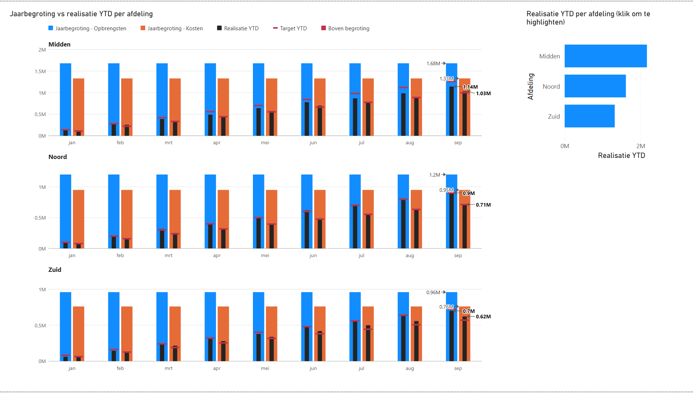
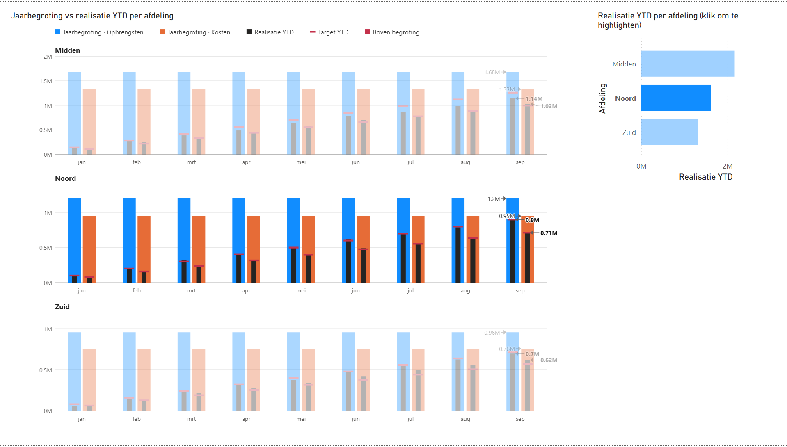

# Budget Bullet Chart

Power BI custom visual for **annual budget versus year-to-date actuals**, with optional revenue/cost split, targets, overrun markers, and cross-highlight support.



## Features

- Vertical or horizontal bullet-style bars (budget range + YTD actual)
- Separate **Opbrengsten** / **Kosten** series (or year-over-year budget/actual pairs)
- One panel per category (e.g. department)
- Target line and overrun indicator
- Legend field for extra series coloring
- Cross-highlight: partial bars and value labels at the highlighted ends

## Install

1. Download the latest `.pbiviz` from [Releases](https://github.com/TacodeJong/budgetBulletChart/releases) or build locally (`npm install` → `pbiviz package`).
2. In Power BI Desktop: **Insert → More visuals → From a file** and select the `.pbiviz`.

## Sample report

| File | Description |
|------|-------------|
| [`samples/BudgetBulletChart-sample.pbix`](samples/BudgetBulletChart-sample.pbix) | Ready-to-open sample report |
| [`samples/pbip/`](samples/pbip/) | Same report as a Power BI Project (`.pbip`) |
| [`samples/budget-sample.csv`](samples/budget-sample.csv) | Source data |

Pages in the sample:

1. Overview (vertical, target, cross-highlight bar)
2. Horizontal + target
3. Year comparison (2025 / 2026)
4. Legend by category (Soort)

## Screenshots

| | |
|:--:|:--:|
|  |  |
| *Cross-highlight* | *Horizontal layout* |
|  |  |
| *Year comparison* | *Legend field* |

## Build

```bash
npm install
npm test
pbiviz package
```

Requires [Node.js](https://nodejs.org/) and the [Power BI Visuals Tools](https://learn.microsoft.com/en-us/power-bi/developer/visuals/environment-setup) (`pbiviz`).

## Author

T. de Jong — [tictaco.nl](https://tictaco.nl)
